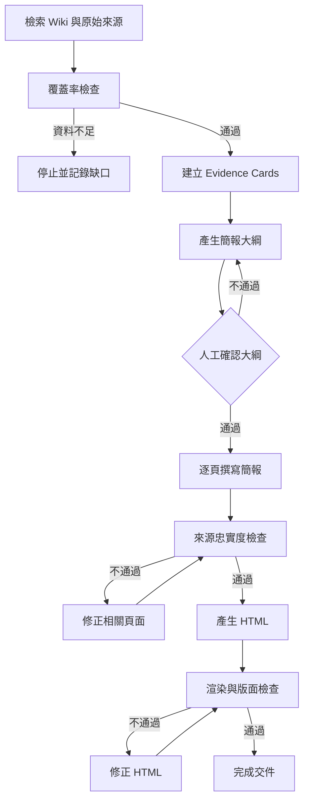

# 簡報製作與檢查報告

## 執行紀錄

| 階段 | 輸入 | 輸出 | 檢查結果 | 退回／修正 | 日期 |
|---|---|---|---|---|---|
| Wiki 檢索 | — | — | 尚未執行 | — | — |
| 覆蓋率關卡 | — | — | 尚未執行 | — | — |
| 證據卡 | — | — | 尚未執行 | — | — |
| 大綱 | — | — | 尚未執行 | — | — |
| 逐頁稿 | — | — | 尚未執行 | — | — |
| 忠實度檢查 | — | — | 尚未執行 | — | — |
| HTML 渲染 | — | — | 尚未執行 | — | — |
| 渲染檢查 | — | — | 尚未執行 | — | — |
| 獨立 AI 審查 | — | — | 尚未執行 | — | — |

## 六項必要檢查

- [ ] 來源檢查
- [ ] 內容檢查
- [ ] 結構檢查
- [ ] 簡報檢查
- [ ] HTML 檢查
- [ ] 獨立 AI 審查

## 反思

- 最容易出錯的節點：
- 哪些檢查提前到上游：
- 發生過的錯誤與退回路徑：
- Loop 次數及停止原因：
- 下次會如何改善：

## Wiki 覆蓋率檢查紀錄

### 檢查目的
確認五個城市的 Wiki 是否涵蓋六大分類，並辨識目前資料不足或尚未完成來源驗證的部分。

### 覆蓋率矩陣

| 城市 | 城市介紹 | 交通票券 | 住宿 | 飲食採買 | 預算 | 景點提醒 |
|---|---|---|---|---|---|---|
| Brno | 待檢查 | 有來源 | 待檢查 | 待檢查 | 待檢查 | 待檢查 |
| Prague | 待檢查 | 有來源 | 待檢查 | 待檢查 | 待檢查 | 待檢查 |
| Vienna | 待檢查 | 待檢查 | 有來源 | 有來源 | 有來源 | 待檢查 |
| Barcelona | 待檢查 | 尚未匯入 | 有來源 | 有來源 | 有來源 | 待檢查 |
| Budapest | 待檢查 | 待檢查 | 待檢查 | 待檢查 | 待檢查 | 待檢查 |

### 已知資料缺口

1. Barcelona 交通票券尚未納入本次來源。
2. Budapest 尚未納入本次五篇來源。
3. 其他標示待檢查的分類，需要確認原有 Wiki 內容及其來源。
4. 五篇來源均須完成原文、日期、數字及引用核對。

### 覆蓋率關卡結果

目前狀態：部分通過，尚未達到完整覆蓋。

處理原則：
- 有可靠來源的內容才可進入簡報。
- 沒有來源的內容標記為待補，不得自行推測。
- 不同城市的價格必須確認年份、幣別及統計口徑。
- 覆蓋率不足時，退回 Wiki 檢索或來源匯入階段。

### 下一階段准入條件

- [ ] 五篇來源均完成原文核對
- [ ] Wiki 重要主張均可追溯至來源
- [ ] 五城市比較資料使用一致口徑
- [ ] 簡報大綱只使用已核准的資料

檢查日期：2026-11-23
檢查者：專案作者

## Graph 與 Loop 工作流程設計

### 一、設計目標

本專案採用 Graph 作為主要工作流程，搭配有限次數的 Loop 進行局部修正。

Graph 負責規定各階段的執行順序及檢查關卡；Loop 則負責處理特定階段中發現的錯誤，避免每次出錯都重新執行整個流程。

### 二、Graph 主流程

### 三、各節點的工作與限制

| 節點 | 工作內容 | 通過條件 |
|---|---|---|
| Wiki 檢索 | 搜尋五個城市的相關資料 | 找到可追溯來源 |
| 覆蓋率檢查 | 檢查六大分類及資料缺口 | 不使用無來源資料 |
| Evidence Cards | 逐篇整理主張、引用與來源 | 主張可回到原始來源 |
| 簡報大綱 | 規劃教學章節與順序 | 人工確認 |
| 逐頁撰寫 | 根據大綱及證據卡撰寫 | 每頁內容有依據 |
| 忠實度檢查 | 核對數字、引用與來源 | 沒有無根據的主張 |
| HTML 產生 | 將核准內容轉換成簡報 | 不擅自改寫已核准內容 |
| 渲染檢查 | 檢查排版、導覽與顯示 | 頁面可正常閱讀及操作 |

### 四、Loop 設計

本專案設置三種局部修正迴圈：

1. **內容修正 Loop**：發現簡報內容與來源不符時，只重新處理相關頁面，不重新生成整份簡報。
2. **引用修正 Loop**：發現引用或數字無法追溯時，回到 Evidence Card 核對原始來源。
3. **HTML 渲染 Loop**：發現文字溢出、圖片顯示異常或導覽失效時，只修正 HTML 或相關頁面。

每個局部 Loop 最多執行兩輪修正。若仍無法通過，停止自動修正並記錄問題，交由人工判斷。

### 五、為什麼採用 Graph 搭配 Loop？

本專案有明確的資料處理順序，因此適合使用 Graph 控制整體流程。每個階段都有明確輸入、輸出及通過標準，能避免 AI 跳過來源檢查或直接產生未經確認的內容。

另一方面，內容撰寫與 HTML 排版可能需要反覆調整，因此使用局部 Loop。這樣能將錯誤退回最接近的處理節點，減少重複工作，也保留每個階段的檢查紀錄。

### 六、停止條件

- 來源不足或無法確認：停止相關內容的生成。
- 大綱未經人工確認：不得進入逐頁撰寫。
- 來源忠實度未通過：不得進入 HTML 生成。
- HTML 渲染檢查未通過：不得交件。
- 局部修正超過兩輪仍未通過：停止並記錄，交由人工處理。

以上設計讓整個流程具有可追蹤性、可重複執行性及明確的品質控制。

## 來源忠實度檢查紀錄

### 檢查方式
由 ChatGPT 協助逐頁比對 Wiki、Evidence Cards 及簡報初稿，檢查內容是否有來源支持。

### 檢查項目
1. 重要主張是否有來源支持。
2. 數字、日期及幣別是否一致。
3. 原文引用是否正確。
4. 是否將估算值誤寫成確定價格。
5. 是否清楚標示資料缺口。

### 修正原則
- 只修改未通過檢查的內容。
- 不自行補充沒有來源支持的數據。
- Budapest 標示為待補官方資料。
- 保留檢查結果及修改紀錄。

### 檢查結果
待執行。

檢查工具：ChatGPT 輔助人工審查。

